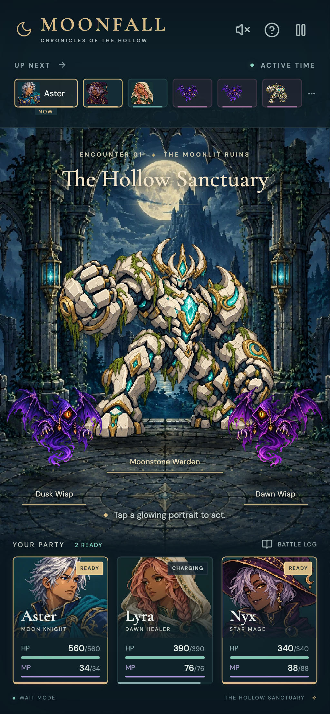

# Verification

Verified October 28, 2026.

- 20 deterministic Vitest checks passed, covering independent ATB gauges, command Wait mode, actor selection, damage, healing, MP and item costs, cancellation, revival, guard mitigation, enemy AI, victory, defeat, replay, and a complete winning battle.
- 22 Playwright checks passed across iPhone 13 WebKit (390×664 device viewport), iPhone SE WebKit (320×568), and mobile Chromium (390×844). The two WebKit instances of the CDP-specific native swipe test are intentionally skipped; WebKit still runs every touch-tap combat/menu test.
- Native Chromium touchStart/touchMove/touchEnd swipes scroll the item list without changing battlefield bounds.
- Manual in-app browser inspection at 390×844 and 320×568 confirmed pixel-art visibility, the fixed battlefield, all six upcoming-turn icons, and command overlay composition.
- Strict TypeScript checking and the Vite production build passed. Production assets use relative URLs for GitHub Pages subdirectory hosting.
- Optimized delivery art totals approximately 596 KB. The complete static build is approximately 1.2 MB, including bundled fonts and license files.
- Dependency audit reported no known vulnerabilities at verification time.

These are browser emulation and visual checks, not physical iPhone hardware testing.

